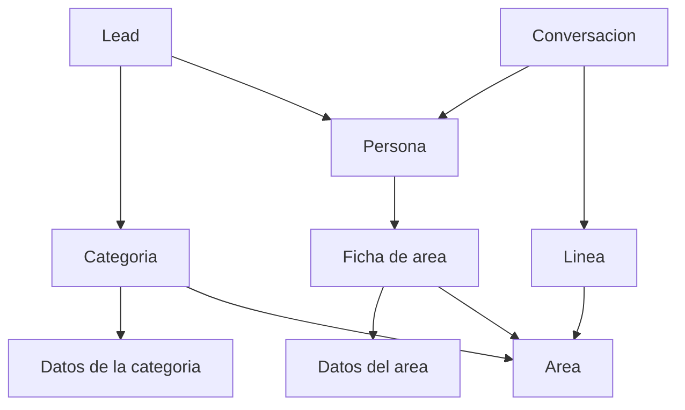

# Modelo: persona, área, categoría y línea

Documento de decisión. Relacionado: [CRM-API.md](./CRM-API.md), [LEADS.md](./LEADS.md), [ROLES-PERMISOS.md](./ROLES-PERMISOS.md), [REGLAS-CONSOLIDACION-EDUCACION.md](./REGLAS-CONSOLIDACION-EDUCACION.md).

mali-whatsapp es el motor y la fuente de verdad. MALI ONE es el puesto de trabajo de fichas, leads, categorías y líneas, y habla con este sistema por API. El chat de los asesores permanece aquí. MALI ONE no guarda otra base de personas ni de leads.

## Entidades

| Nombre | Tabla | Qué es |
|--------|--------|--------|
| Línea | `whatsapp_lines` | Número de la API de WhatsApp. Varias por área. La conversación es una por línea. |
| WABA | `whatsapp_wabas` | Cuenta Meta: plantillas, suscripción y token compartido. No es el tenant. |
| Área | `business_areas` | Tenant aislado: inbox, permisos y ficha. PAM, Patronato y TI no se fusionan con Educación. |
| Categoría | `business_programs` | Producto o servicio del área. En la API se llama `categoria`. Educación tiene `ca` y `ep`. Las demás áreas pueden no tener categorías. |
| Persona | `people` | Una sola. Datos perennes: nombre, apellido, teléfono, correo, DNI, fecha de nacimiento e identidad de WhatsApp. |
| Ficha de área | `contacts` | Una ficha activa por persona y área canónica. Opt-in y relación con esa área. |
| Datos del área | `contact_attributes` con `program_id` nulo | Información que cambia según el área (suscripción, sede). |
| Datos de la categoría | `contact_attributes.program_id` | Información que cambia según la categoría (curso, modalidad). |
| Lead | `contact_origins` + `education_lead_entries` | Solo Educación. Un intento de contacto hacia una categoría. Puede haber muchos. |
| Ciclo | `education_lead_cycles` | Estado y asesor de una categoría. Una persona puede tener un ciclo de CA y otro de EP. |

Los alias `educacion_ca` y `educacion_ep` se aceptan en la API y se guardan como categoría. No crean otra persona ni otra ficha.

## Identidad

El match de la persona es global, en este orden: identidad de WhatsApp, teléfono, DNI, correo. Si hay una sola persona, se reutiliza y se completan los huecos. Si no hay ninguna, se crea la persona y la ficha del área. Si las claves apuntan a personas distintas, o el DNI o la identidad de WhatsApp no coinciden, se anota en `person_identity_reviews` y no se abre otra persona.

La ficha se busca por persona y área canónica. El aislamiento entre áreas es de la ficha, del inbox y de los permisos. La persona sigue siendo la misma.

## Límite con MALI ONE

| mali-whatsapp | MALI ONE |
|---------------|----------|
| Líneas, envío, recepción y webhook | Pantallas de fichas, leads y administración de líneas |
| Persona, ficha, categoría, lead y conversación | El trabajo sobre esos datos, sin cambiar de línea en esta aplicación |
| Reglas de identidad y de lead | `CRM_SERVICE_TOKEN` para fichas y leads; `WHATSAPP_ADMIN_SERVICE_TOKEN` para líneas |

El chat no se mueve a MALI ONE. La campaña sigue usando la línea de la conversación o, si no hay, la predeterminada del área.

## Datos históricos

Hasta ejecutar la consolidación de Educación, pueden quedar varias fichas con el mismo teléfono en `educacion`, `educacion_ca` y `educacion_ep`. El script [api/scripts/consolidate-education.cjs](../api/scripts/consolidate-education.cjs) deja una ficha y una persona por grupo fusionable, y conserva la categoría. Los grupos en revisión no se fusionan. No se ejecuta sobre producción hasta ensayarlo en una copia con este código.
