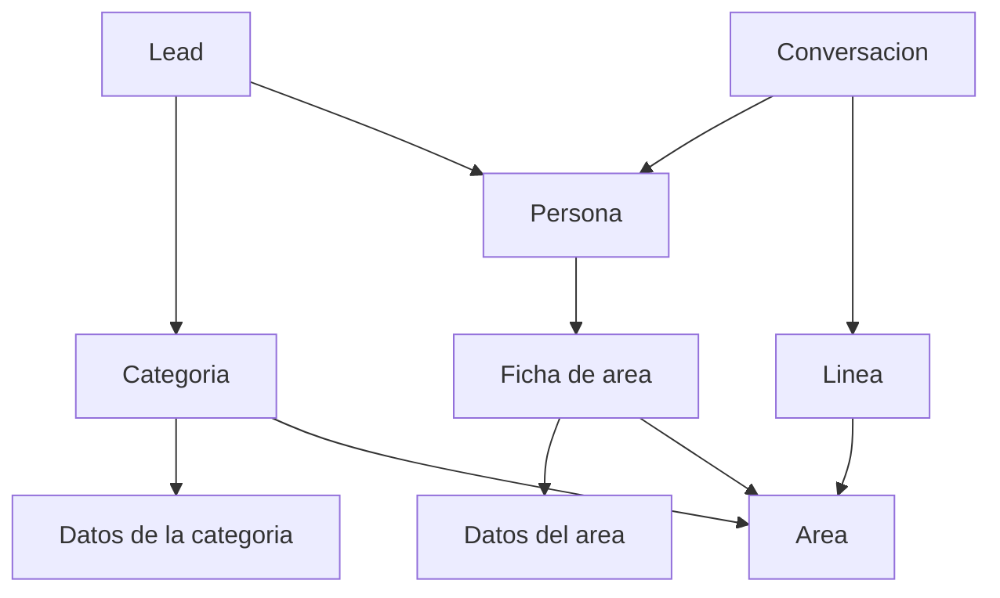

# Modelo: persona, área, categoría y línea

Documento de decisión. Relacionado: [CRM-API.md](./CRM-API.md), [LEADS.md](./LEADS.md), [ROLES-PERMISOS.md](./ROLES-PERMISOS.md), [REGLAS-CONSOLIDACION-EDUCACION.md](./REGLAS-CONSOLIDACION-EDUCACION.md).

mali-whatsapp es el motor y la fuente de verdad. El chat de los asesores permanece aquí. MALI ONE habla con este sistema por API y no guarda otra base de personas ni de leads. Usuarios, categorías, líneas y conflictos se administran en mali-whatsapp. Más adelante MALI ONE puede crear categorías y leer permisos por la misma API, sin una copia propia. Las líneas se quedan en este canal: ahí viven el token, la WABA y el webhook.

## Entidades

| Nombre | Tabla | Qué es |
|--------|--------|--------|
| Línea | `whatsapp_lines` | Número de la API de WhatsApp. Varias por área. La conversación es una por línea. |
| WABA | `whatsapp_wabas` | Cuenta Meta: plantillas, suscripción y token compartido. No es el tenant. |
| Área | `business_areas` | Tenant aislado: inbox, permisos y ficha. Hay cuatro: TI, PAM, Patronato y Educación. No se crea una quinta desde la pantalla. PAM, Patronato y TI no se fusionan con Educación. |
| Categoría | `business_programs` | Producto o servicio del área. En la API se llama `categoria`. General no es una fila: es `program_id` nulo. CA y EP son filas. Una categoría nueva se crea en Administración → Áreas, sin cambiar código. El identificador tiene hasta 10 letras, empieza por una letra y no puede ser `general`. Se da de baja solo si no tiene líneas activas. Las demás áreas pueden no tener categorías. |
| Persona | `people` | Una sola. Datos perennes: nombre, apellido, teléfono, correo, DNI, fecha de nacimiento e identidad de WhatsApp. |
| Ficha de área | `contacts` | Una ficha activa por persona y área canónica. Opt-in y relación con esa área. |
| Datos del área | `contact_attributes` con `program_id` nulo | Información que cambia según el área (suscripción, sede). |
| Datos de la categoría | `contact_attributes.program_id` | Información que cambia según la categoría (curso, modalidad). |
| Lead | `contact_origins` + `education_lead_entries` | Solo Educación. Un intento de contacto hacia una categoría. Puede haber muchos. |
| Ciclo | `education_lead_cycles` | Estado y asesor de una categoría. Una persona puede tener un ciclo de CA y otro de EP. |

Los alias `educacion_ca` y `educacion_ep` se aceptan en la API y se guardan como categoría. No crean otra persona ni otra ficha.

## Identidad

El match de la persona es global, en este orden: identidad de WhatsApp, teléfono, DNI, correo. Si hay una sola persona, se reutiliza y se completan los huecos. Si no hay ninguna, se crea la persona y la ficha del área. Si las claves apuntan a personas distintas, o el DNI o la identidad de WhatsApp no coinciden, se anota en `person_identity_reviews` y no se abre otra persona.

La ficha se busca por persona y área canónica. El aislamiento entre áreas es de la ficha, del inbox y de los permisos. La persona sigue siendo la misma.

## Límite con MALI ONE

| mali-whatsapp | MALI ONE |
|---------------|----------|
| Líneas, envío, recepción, webhook y su administración | Puede llamar la misma API; no administra el token ni la WABA |
| Persona, ficha, categoría, lead, conversación y la revisión de conflictos | El trabajo sobre fichas y leads, sin otra base |
| Reglas de identidad y de lead | `CRM_SERVICE_TOKEN` para fichas y leads; `WHATSAPP_ADMIN_SERVICE_TOKEN` para líneas |

El chat no se mueve a MALI ONE. La respuesta de un chat sale por la línea de esa conversación. La campaña elige una línea de las categorías de su audiencia. Si el envío trae categorías y no trae línea, la API lo rechaza. Sin filtro de categoría se usa la línea predeterminada del área.

Una línea nueva se da de alta en Administración → Líneas. Queda inactiva. El orden es crearla, Validar en Meta y Activar. El token sale de la WABA. Moverla de categoría cambia solo el programa: el teléfono y la WABA siguen, y los chats de ese número se ven en la categoría nueva. Desactivar la apaga.

Una categoría nueva no entra sola en los usuarios que ya tenían acceso. Hay que abrir cada usuario y marcarla. Master ve todas.

## Datos históricos

La consolidación de Educación ya se aplicó en producción el 26 de octubre de 2026. El script [api/scripts/consolidate-education.cjs](../api/scripts/consolidate-education.cjs) dejó una ficha y una persona por grupo fusionable. Los grupos en revisión no se fusionaron. Se resuelven a mano en Administración → Conflictos. Las reglas y los dos botones de cada caso están en [REGLAS-CONSOLIDACION-EDUCACION.md](./REGLAS-CONSOLIDACION-EDUCACION.md).
